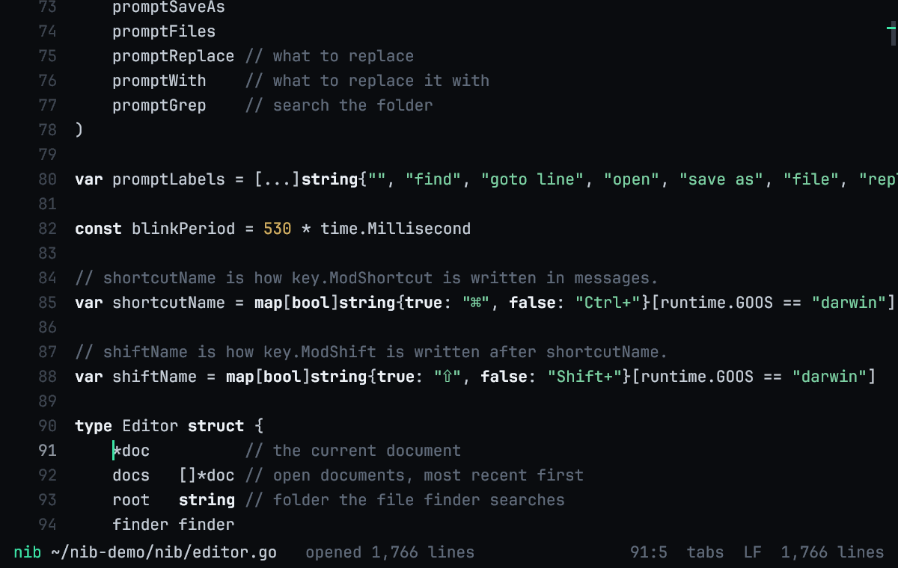
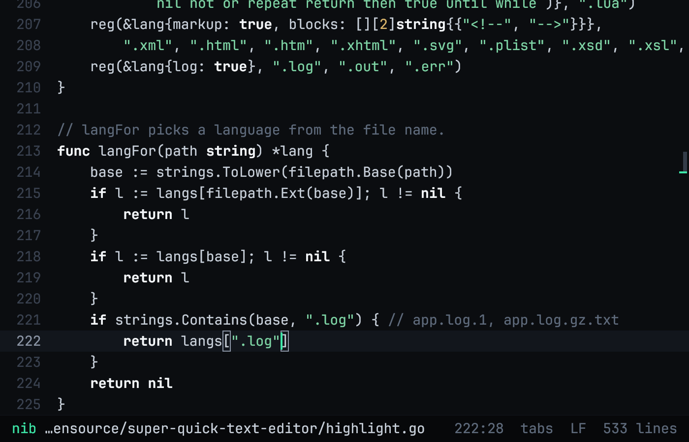
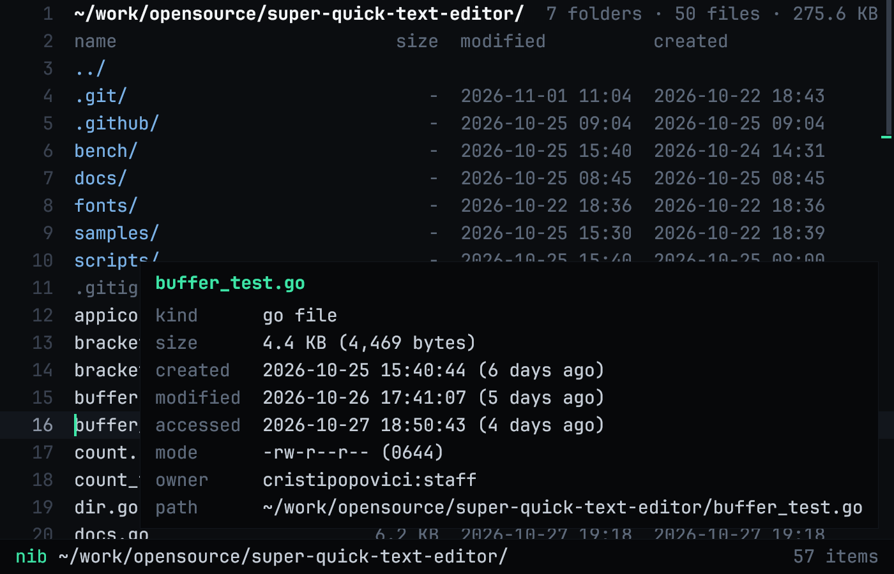
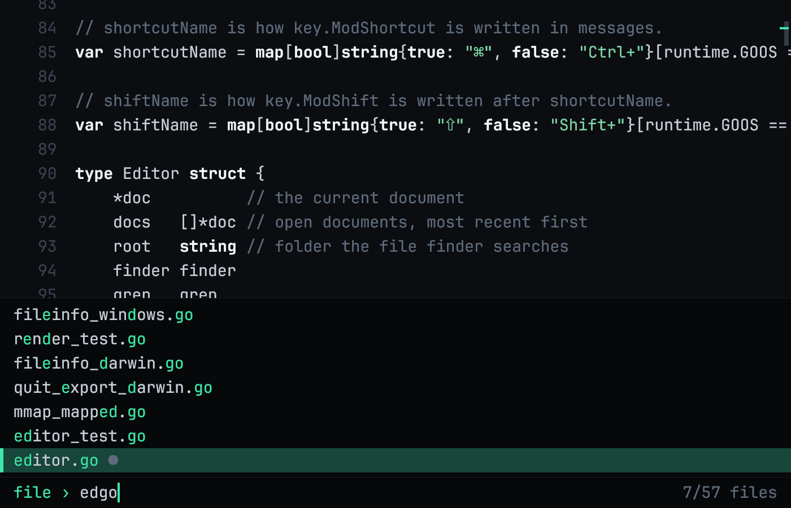

<p align="center">
  
</p>

<h1 align="center">nib</h1>

<p align="center">
  <b>A small, fast text editor for files of any size.</b><br>
  A 2 GB file is on screen in under a second, in under 300 MB of memory.
</p>

<p align="center">
  <a href="https://github.com/hipjim/nib/releases/latest"></a>
  <a href="https://github.com/hipjim/nib/actions/workflows/ci.yml"></a>
  
  <a href="LICENSE"></a>
</p>

<p align="center"></p>
<p align="center"><sub>Recorded from the editor itself by <code>go test -run TestGif</code>; the times in the status bar are measured.</sub></p>

nib is a plain text editor that stays fast no matter what you open: a log of
millions of lines, a database dump, a minified bundle with one 18 MB line. It
is drawn on the GPU, written in Go with [Gio](https://gioui.org), and ships as
one ~10 MB binary for macOS, Linux and Windows.

## Why nib

- **Huge files open instantly.** A 2 GB file is on screen in 0.6 s and fully
  indexed in about 2 s. Editing, finding and saving stay fast too: an edit
  takes ~30 µs even in a 22-million-line file.
- **Light.** About 120–300 MB of memory, whether the file is 3 KB or 2 GB.
- **A real editor.** Undo, several open files, find and replace, search across
  a folder, syntax highlighting, folder browsing and a fuzzy file finder, with
  the keys you already know.
- **Never loses work.** It asks before quitting with unsaved files, restores
  your last session, and reloads files that change on disk, following
  growing logs like `tail -f`.

## Install

On macOS, with [Homebrew](https://brew.sh):

```sh
brew tap hipjim/nib https://github.com/hipjim/nib
brew install --cask --no-quarantine nib
```

Homebrew asks once whether to trust the tap. That puts `nib.app` in
Applications and `nib` on your `PATH`. The app is not notarized yet, which is
what `--no-quarantine` is for. `brew upgrade nib` picks up new releases.

Or download the latest build from the
[releases page](https://github.com/hipjim/nib/releases/latest):

| Platform | Download | Notes |
| --- | --- | --- |
| macOS (Apple Silicon and Intel) | `nib-…-macos-universal.zip` | Unzip and move `nib.app` to Applications. It is not notarized yet, so the first time right-click it and choose **Open**. |
| macOS command line | `nib-…-macos-universal.tar.gz` | Put `nib` on your `PATH`. |
| Linux (x86-64, ARM) | `nib-…-linux-amd64.tar.gz` / `-arm64` | Uses the system's Wayland or X11. |
| Windows (x86-64, ARM) | `nib-…-windows-amd64.zip` / `-arm64` | SmartScreen may warn about an unknown publisher: **More info → Run anyway**. |

Or build it with Go 1.26 or newer:

```sh
go install github.com/hipjim/nib@latest
```

On Linux, building needs a C compiler and the Wayland/X11 development
packages; see [Gio's install notes](https://gioui.org/doc/install).

## Using it

```sh
nib file.txt    # open a file
nib .           # browse a folder
nib             # pick up where you left off
```

### Editing

Everything you would expect, and fast in files of any size: undo and redo,
selections with the mouse and keyboard, word moves, auto-indent, indenting and
dedenting blocks, moving and duplicating lines, copying the whole line when
nothing is selected, `⌘/` to comment lines out, and `⌘D` to select the next
occurrence of a word. Brackets and quotes close themselves as you type them,
wrap the selection, and are skipped over when typed again. The bracket at the
cursor and its partner are outlined, indent guides run through blocks, and
`⌘⇧I` shows every space and tab. Tabs or spaces and LF or
CRLF line endings are detected and kept. `⌘⇧/` lists every key.

### Open files

With two or more files open, a tab bar lists them in the order they were
opened, with a dot on the unsaved ones. Click a tab to switch, middle-click
to close it. `Ctrl+Tab` and `Ctrl+⇧Tab` go to the next and previous tab,
`⌘1` to `⌘9` to the nth, `⌘W` closes the current file and `⌘⇧W` every
other saved one. `⌘P` with nothing typed lists the open files most recent
first, so `⌘P`, `Enter` switches back to the last one.

<p align="center"></p>

### Find, replace and search the folder

- **`⌘F`** finds as you type, from the cursor; `Enter` goes to the next match
  and the status bar counts them ("3 of 128").
- **`⌘R`** replaces: type what to find, `Enter`, then the replacement. `Enter`
  replaces the selected match and moves on, `↓` skips it, and `⌘Enter`
  replaces every match in the file as one undo step (5 million matches in a
  500 MB file take 0.16 s).
- **`⌘⇧F`** searches every file under the folder as you type and lists each
  matching line. `Enter` opens the file with the match selected, and `F3`
  goes on to the next one in that file. Binary files, `.git`, `node_modules`
  and `.gitignore` matches are skipped.

A lower-case query ignores case; one with a capital letter matches exactly.

### Folders, the file finder and file properties

<p align="center">
  
  
</p>

- **Folders** open as a listing with size, modified and created dates. `⌘O`
  shows the current file's folder with the file selected. Type a few letters
  of a name to jump to it, as in Finder. `Enter` opens, `←` or `Backspace`
  goes up, and `⌘E` goes up from a file or a listing. `⌘⇧O` opens a file or
  folder by typing its path; `Tab` completes it.
- **`⌘P`**, or tapping Shift twice, finds any file under the folder from a few
  letters of its path, like fzf: `edgo` finds `editor.go`. The folder is the
  one nib was started in or last opened. It skips `.git`, `node_modules` and
  `.gitignore` matches, and ranks 40,000 paths in a millisecond. Files you
  have open are listed first and marked with a dot.
- **`⌘I`** shows a file's properties: size, lines, created, modified and
  accessed times, permissions and owner.
- **`⌘T`** opens a terminal in the folder of the current file: on macOS the
  terminal nib was started from (Terminal, iTerm, Ghostty, WezTerm or Warp),
  on Linux `$TERMINAL` or the first one installed, on Windows Windows Terminal
  or `cmd`. Set `NIB_TERMINAL` to choose another.

### Syntax highlighting

Comments, strings, numbers and keywords for Go, C/C++, Rust,
JavaScript/TypeScript, Java and friends, Python, shell, Ruby, SQL, Lua, CSS,
JSON, YAML/TOML/INI and XML/HTML. Log files get dimmed timestamps and red
`ERROR` / amber `WARN`. Only the lines on screen are scanned, so it costs the
same in a 2 GB file as in a 2 KB one. `⌘⇧H` turns it off.

### Never losing work

- Quitting or closing the window with unsaved files asks first; quit again to
  discard them.
- `nib` with no arguments reopens your last files where you left them. A
  restored file you do not touch for two sessions in a row is dropped, so a
  file opened once by accident does not come back forever.
- Files that change on disk reload by themselves. With the cursor on the last
  line, nib follows new lines like `tail -f`. A file you have edited is never
  replaced, and saving over a newer version on disk asks first.

## Keys

`⌘` is Ctrl on Linux and Windows. Word moves use Alt on macOS and Ctrl elsewhere.

| Key | Action |
| --- | --- |
| `⌘S` / `⌘⇧S` | save / save as |
| `⌘P` or `⇧⇧` | find a file in the folder (`↑` / `↓` pick, `Enter` opens) |
| `⌘O` / `⌘⇧O` | browse the file's folder / open a path (`Tab` completes) |
| `⌘E` | show the current file's folder |
| `⌘I` / `⌘⇧I` | file properties / show spaces and tabs |
| `⌘T` | open a terminal in the file's folder |
| `⌘W` / `⌘⇧W` | close the file / every other saved file |
| `Ctrl+Tab` / `Ctrl+⇧Tab` | next / previous tab |
| `⌘1` … `⌘9` | go to that tab |
| `⌘Q` | quit (asks if anything is unsaved) |
| `⌘F`, then `Enter` / `⇧Enter` / `F3` | find next / previous |
| `⌘R`, then `Enter` / `⌘Enter` / `↓` | replace this match / all of them / skip |
| `⌘⇧F` | search every file in the folder (`↑` / `↓` pick, `Enter` opens) |
| `⌘G` | go to `line[:col]` |
| `⌘Z` / `⌘⇧Z` / `⌘Y` | undo / redo |
| `⌘C` / `⌘X` / `⌘V` | copy / cut / paste (no selection: the whole line) |
| `⌘D` | select the word, then its next occurrence |
| `⌘L` | select the line (repeat to extend) |
| `⌘⇧D` / `⌘⇧K` | duplicate / delete the line |
| `Alt↑` / `Alt↓` | move the line up / down |
| `Tab` / `⇧Tab` | indent / dedent (works on selections) |
| `⌘=` / `⌘-` / `⌘0` | zoom in / out / reset |
| `⌘⇧H` | syntax highlighting on / off |
| `⌘⇧L` | light / dark theme (remembered) |
| `⌘/` | comment the lines out, or back in |
| `⌘⇧/` or `F1` | show this list in the editor |
| `Esc` | clear the selection, close a prompt or panel |

Double-click selects a word, triple-click a line. Drag the scrollbar, or click
anywhere on it to jump there.

## How it is fast

- **Only what is on screen is drawn**, on the GPU, and only those lines are
  highlighted.
- **Big files are memory-mapped**, not copied. Lines are found in the
  background on all cores, so the first screen appears right away.
- **Lines live in blocks of 1,024** that store 4-byte offsets into the file
  until edited. An edit touches one small block: ~30 µs even in a
  22-million-line file.
- **Long lines stay fast.** nib remembers where every 4 KB of a long line
  falls on screen, so working at the end of an 18 MB minified JSON line takes
  0.04 ms a frame, the same as at its start.
- **Find searches the file on all cores**, jumping between the query's rarest
  byte, or, when every byte is common, skipping ahead Horspool-style on pairs
  of bytes with four parts of the text in flight at once. A 500 MB file is
  searched in 5–20 ms.
- **Replace-all rewrites the matched lines on all cores**, each core cutting
  its new lines from one buffer: 5 million matches in 500 MB in 0.16 s.
- **Searching the folder** lists it on all cores and reads files a megabyte at
  a time while the listing is still going: 40,000 files (1.7 GB) in under a
  second once listed.
- **Saving writes unedited parts straight from the original file**: 2 GB in 1.3 s.
- **Startup works while the window opens**: the file loads and the first screen
  is laid out before the first frame.

### Compared to other editors

Time until the editor is ready after opening, and its memory, on an M4 Mac
with 16 GB (October 2026, medians of 3 runs, 1 for 2 GB):

| Opening | nib 0.3.1 | Zed 1.25.3 | Sublime Text 4215 |
| --- | --- | --- | --- |
| 9 MB C source | 0.7 s · 171 MB | 2.6 s · 347 MB | 2.0 s · 289 MB |
| 100 MB XML | 0.4 s · 178 MB | 2.6 s · 479 MB | 5.4 s · 529 MB |
| **2 GB XML** | **2.2 s · 256 MB** | **39 s · 6.3 GB** | **87 s · 3.0 GB** |
| Folder of 40,000 files | 0.3 s · 134 MB | 1.9 s · 206 MB | 1.4 s · 274 MB |

Zed ran with language servers off and Sublime in `--safe-mode` (default
settings, no packages). Both do more work on open than nib: they highlight the
whole file, and Zed also tracks git and indexes the folder. That pays off in
everyday code, while nib does only what is on screen. Run
`bench/run.sh <file or folder>` to measure on your Mac.

## Development

```sh
go test ./...                                                 # tests
NIB_FILE=big.xml go test -run '^$' -bench Big .               # load, edit, find and save benchmarks
NIB_SHOT=out.png NIB_FILE=main.go go test -run TestRender .   # offscreen screenshot
NIB_GIF=docs/demo.gif go test -run TestGif .                 # the README demo, needs ~1 GB of disk for a while
```

Every push is tested on macOS, Linux and Windows. Pushing a tag like `v1.2.3`
builds every platform and publishes a release
([`release.yml`](.github/workflows/release.yml)). `scripts/macos-app.sh`
builds the macOS app locally, and `NIB_ICON=appicon.png go test -run TestIcon .`
redraws the icon.

nib is young. Bug reports and ideas are welcome in
[issues](https://github.com/hipjim/nib/issues).

## The name

A *nib* is the tip of a pen: the small part that does the writing. It was
called quod until version 0.2.

## License

MIT. Text is set in [JetBrains Mono](https://www.jetbrains.com/lp/mono/) (NL,
no ligatures), embedded in the binary under the SIL Open Font License
(`fonts/OFL.txt`).
