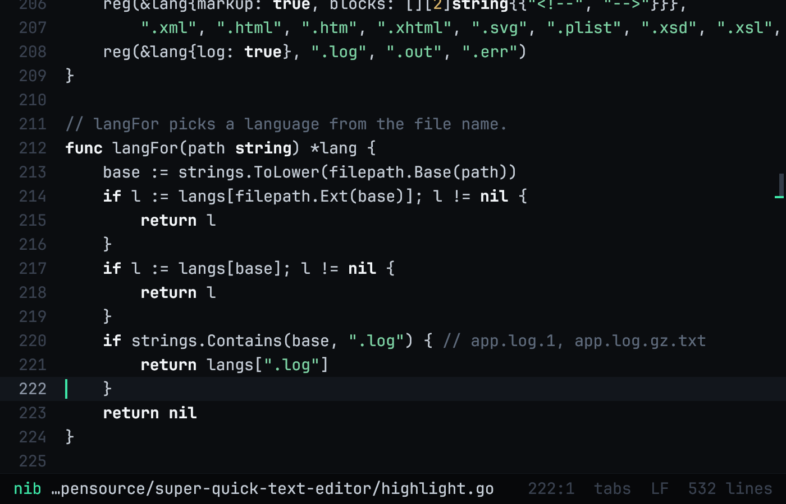
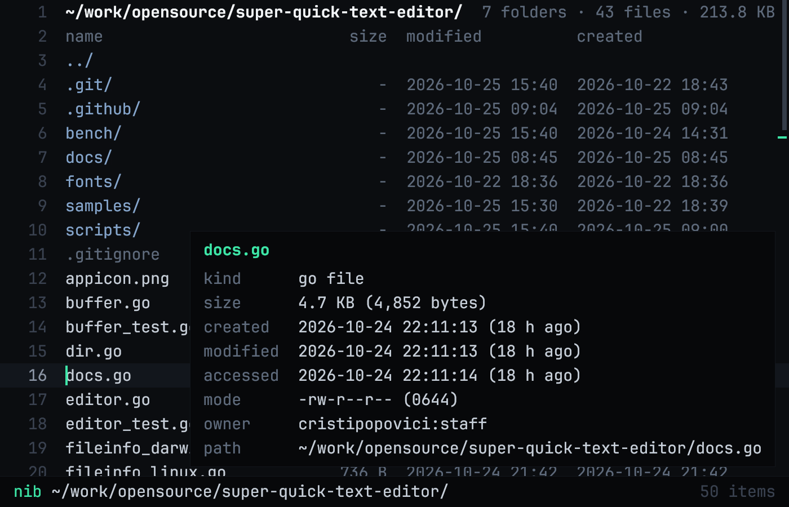
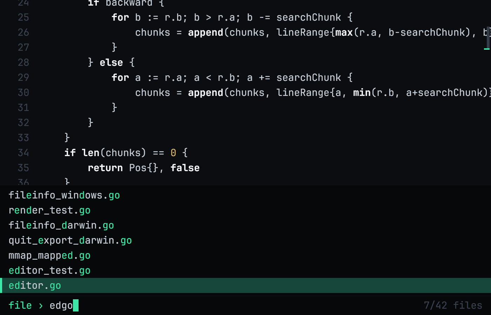

# quod

[](https://github.com/hipjim/quod/actions/workflows/ci.yml)
[](https://github.com/hipjim/quod/releases/latest)

**A tiny, very fast text editor, drawn on the GPU.**
It opens a 2 GB file in about a second with under 300 MB of memory, and stays
quiet, dark and out of your way. Written in Go with [Gio](https://gioui.org);
runs on macOS, Linux and Windows. One binary of about 10 MB, nothing else to
install.

<p align="center"></p>

## Why quod

- **Instant on huge files.** The first screen of a 2 GB file shows up in ~20 ms;
  the rest is indexed in the background in under a second. Zed needs ~39 s and
  6 GB for the same file ([numbers below](#compared-to-zed)).
- **Small and light.** Memory stays at 110–280 MB whether the file is 3 KB or
  2 GB. A frame takes about 0.1 ms to lay out.
- **A real editor.** Undo, several open files, find and replace, search across
  a folder, syntax highlighting, folder browsing and a fuzzy file finder, with
  keys you already know.
- **Never loses work.** It asks before quitting with unsaved files, restores
  your last session, and reloads files that change on disk.

## Install

**Download** the latest build from the
[releases page](https://github.com/hipjim/quod/releases/latest):

| Platform | Download | Notes |
| --- | --- | --- |
| macOS (Apple Silicon and Intel) | `quod-…-macos-universal.zip` | Unzip and move `quod.app` to Applications. It is not notarized yet: the first time, right-click it and choose **Open**. |
| macOS command line | `quod-…-macos-universal.tar.gz` | Put `quod` on your `PATH`. |
| Linux (x86-64, ARM) | `quod-…-linux-amd64.tar.gz` / `-arm64` | Uses the system's Wayland or X11. |
| Windows (x86-64, ARM) | `quod-…-windows-amd64.zip` / `-arm64` | SmartScreen may warn about an unknown publisher: **More info → Run anyway**. |

**Homebrew** (macOS), built from source:

```sh
brew install hipjim/tap/quod
```

**Go** 1.26 or newer:

```sh
go install github.com/hipjim/quod@latest
```

On Linux, building needs a C compiler and the Wayland/X11 development
packages; see [Gio's install notes](https://gioui.org/doc/install). To build
from a clone:

```sh
git clone https://github.com/hipjim/quod && cd quod
go build -o quod . && ./quod file.txt
```

`quod --version` prints the version.

## Using it

```sh
quod file.txt    # open a file
quod .           # browse a folder
quod             # pick up where you left off
```

### Editing

Everything you would expect, and fast in files of any size: undo and redo,
selections with the mouse and keyboard, word moves, auto-indent, indenting and
dedenting blocks, moving and duplicating lines, copying the whole line when
nothing is selected, and `⌘D` to select the next occurrence of a word. Tabs or
spaces and LF or CRLF line endings are detected and kept.

### Find, replace and search the folder

- **`⌘F`** finds as you type, from the cursor; `Enter` goes to the next match.
- **`⌘R`** replaces: type what to find, `Enter`, then the replacement. `Enter`
  replaces the selected match and moves on, `↓` skips it, and `⌘Enter`
  replaces every match in the file as one undo step (a million matches in a
  100 MB file take a quarter of a second).
- **`⌘⇧F`** searches every file under the folder as you type and lists each
  matching line. `Enter` opens the file with the match selected, and `F3`
  goes on to the next one in that file. Binary files, `.git`, `node_modules`
  and `.gitignore` matches are skipped.

A lower-case query ignores case; one with a capital letter matches exactly.

### Syntax highlighting

Comments, strings, numbers and keywords for Go, C/C++, Rust,
JavaScript/TypeScript, Java and friends, Python, shell, Ruby, SQL, Lua, CSS,
JSON, YAML/TOML/INI and XML/HTML. Log files get dimmed timestamps and red
`ERROR` / amber `WARN`. Only the lines on screen are scanned, so it costs the
same in a 2 GB file as in a 2 KB one. `⌘⇧H` turns it off.

### Folders, the file finder and file properties

<p align="center">
  
  
</p>

- **Folders** open as a listing with size, modified and created dates. `Enter`
  opens, `←` or `Backspace` goes up, and `⌘E` jumps from a file to its folder.
- **`⌘P`**, or tapping Shift twice, finds any file under the folder from a
  few letters of its path, like fzf. It walks the folder in the background, skips `.git`,
  `node_modules` and `.gitignore` matches, and ranks 67,000 paths in under 8 ms.
- **`⌘I`** shows a file's properties: size, lines, created, modified and
  accessed times, permissions and owner.

**`⌘T`** opens a terminal in the folder of the current file (or of the
listing). On macOS it opens the terminal app quod was started from (Terminal,
iTerm, Ghostty, WezTerm or Warp), else Terminal; on Linux `$TERMINAL` or the
first one installed; on Windows, Windows Terminal or `cmd`. Set
`QUOD_TERMINAL` to choose another: an app name on macOS, a command elsewhere.

Open files stay open in the background with their cursor, undo history and
unsaved edits; `⌘P` lists them first.

### Never losing work

- Quitting or closing the window with unsaved files asks first; quit again to
  discard them.
- `quod` with no arguments reopens your last files where you left them.
- Files that change on disk reload by themselves. With the cursor on the last
  line, quod follows new lines like `tail -f`. A file you have edited is never
  replaced, and saving over a newer version on disk asks first.

## Keys

`⌘` is Ctrl on Linux and Windows. Word moves use Alt on macOS and Ctrl elsewhere.

| Key | Action |
| --- | --- |
| `⌘S` / `⌘⇧S` | save / save as |
| `⌘P` or `⇧⇧` | find a file in the folder (`↑` / `↓` pick, `Enter` opens) |
| `⌘O` | open a file or folder by path (`Tab` completes) |
| `⌘E` | show the current file's folder |
| `⌘I` | file properties |
| `⌘T` | open a terminal in the file's folder |
| `⌘W` | close the file |
| `⌘Q` | quit (asks if anything is unsaved) |
| `⌘F`, then `Enter` / `⇧Enter` / `F3` | find next / previous (a lower-case query ignores case) |
| `⌘R`, then `Enter` / `⌘Enter` / `↓` | replace this match / all of them / skip |
| `⌘⇧F` | search every file in the folder (`↑` / `↓` pick, `Enter` opens) |
| `⌘G` | go to `line[:col]` |
| `⌘Z` / `⌘⇧Z` / `⌘Y` | undo / redo |
| `⌘C` / `⌘X` / `⌘V` | copy / cut / paste (no selection: the whole line) |
| `⌘D` | select the word, then its next occurrence |
| `⌘L` | select the line (repeat to extend) |
| `⌘⇧D` / `⌘⇧K` | duplicate / delete the line |
| `Alt↑` / `Alt↓` | move the line up / down |
| `Tab` / `⇧Tab` | indent / dedent (works on selections) |
| `⌘=` / `⌘-` / `⌘0` | zoom in / out / reset |
| `⌘⇧H` | syntax highlighting on / off |
| `Esc` | clear the selection, close a prompt or panel |

Double-click selects a word, triple-click a line. Drag the scrollbar, or click
anywhere on it to jump there.

## How it is fast

- **Only what is on screen is drawn**, and it is drawn on the GPU.
- **Big files are memory-mapped**, not copied. Lines are found in the
  background, so the first screen appears right away.
- **Lines live in blocks of 1,024** that store 4-byte offsets into the file
  until edited. An edit touches one small block: ~30 µs even in a
  22-million-line file.
- **Find searches whole pieces of the file on all cores**, jumping between the
  query's rarest byte, or skipping ahead Horspool-style when every byte is
  common. Searching all of a 2 GB file takes 25–230 ms.
- **Replacing all** finds the matching lines on all cores and changes only
  those lines.
- **Searching the folder** reads files a megabyte at a time on all cores,
  while the folder is still being listed: 40,000 files (1.7 GB) in under a
  second once listed.
- **Saving writes unedited parts straight from the original file**: 2 GB in 1.3 s.
- **Highlighting scans only the visible lines** and remembers multi-line
  comments and strings every 1,024 lines.
- **Startup works while the window opens**: the file loads and the first screen
  is laid out before the first frame.

## Compared to Zed

Opening files and a folder on an M4 Mac with 16 GB, against Zed 1.25.2 with
language servers off. Medians of 3 runs (2 for the folder, 1 for 2 GB).

| Opening | quod CPU | Zed CPU | quod memory | Zed memory |
| --- | --- | --- | --- | --- |
| 3 MB text | 0.26 s | 1.1 s | 176 MB | 196 MB |
| 9 MB C source | 0.31 s | 4.2 s | 184 MB | 349 MB |
| 100 MB XML | 0.31 s | 3.3 s | 150 MB | 494 MB |
| **2 GB XML** | **1.2 s** | **46 s** | **273 MB** | **6.2 GB** |
| Folder with 67,000 files | 0.22 s | 4.3 s | 114 MB | 221 MB |

On the 2 GB file quod is ready in ~1 s and Zed in ~39 s. Zed does more: it
parses whole files for highlighting, tracks git and indexes every folder you
open, while quod highlights only the screen and walks a folder only when you
press `⌘P`. Run it yourself with `bench/run.sh <file or folder>` (macOS, with
Zed in `/Applications`).

## Development

Every push is tested on macOS, Linux and Windows. Pushing a tag like `v1.2.3`
builds all platforms and publishes a release
([`.github/workflows/release.yml`](.github/workflows/release.yml)).
`scripts/macos-app.sh` builds the macOS app locally, and
`QUOD_ICON=appicon.png go test -run TestIcon .` redraws the icon.

```sh
go test ./...                                          # tests
QUOD_FILE=big.xml go test -run '^$' -bench Big .       # load, edit, find and save benchmarks
QUOD_SHOT=out.png QUOD_FILE=main.go go test -run TestRender .   # offscreen screenshot
```

## The name

*quod* comes from **quod** erat demonstrandum, in tribute to
[QED](https://en.wikipedia.org/wiki/QED_(text_editor)) (1965), the editor that
led to `ed`, `vi` and everything after.

## License

MIT. Text is set in [JetBrains Mono](https://www.jetbrains.com/lp/mono/) (NL, no
ligatures), embedded in the binary under the SIL Open Font License
(`fonts/OFL.txt`).
